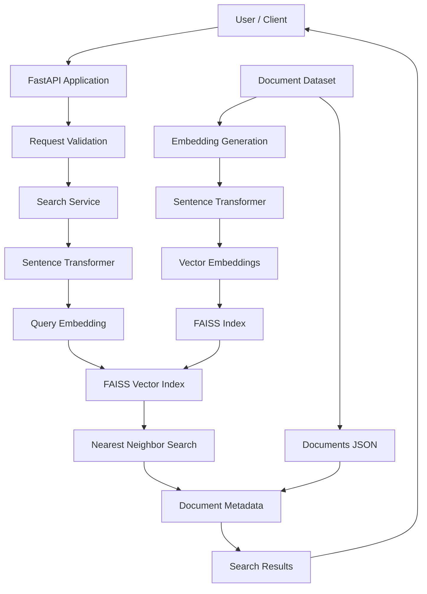

# Scalable Semantic Search API with FAISS and FastAPI
[](https://fastapi.tiangolo.com)
[](https://www.python.org/)
[](https://github.com/facebookresearch/faiss)
[](https://sbert.net)
[](https://www.docker.com/)
[-brightgreen?style=flat&logo=pytest&logoColor=white)](https://docs.pytest.org)

## Project Overview

The **Scalable Semantic Search API with FAISS and FastAPI** is a high-performance semantic search application that retrieves relevant documents based on their meaning and contextual similarity rather than relying only on exact keyword matching.

The project uses **Sentence Transformers** to convert textual data into numerical vector embeddings and **FAISS (Facebook AI Similarity Search)** to perform efficient vector similarity searches.

Built using **FastAPI**, the application exposes REST API endpoints that allow users to submit natural-language queries and retrieve the most relevant documents.

The system demonstrates an end-to-end semantic search pipeline, including document generation, embedding creation, vector indexing, similarity retrieval, API development, Docker deployment, and automated testing.

## Key Features

- **Semantic Search:** Retrieves documents based on contextual meaning rather than exact keyword matches.
- **Transformer-Based Embeddings:** Uses the pre-trained `all-MiniLM-L6-v2` model to generate text embeddings.
- **Vector Similarity Search:** Uses FAISS for efficient nearest-neighbor retrieval.
- **FastAPI Integration:** Provides RESTful endpoints for search operations.
- **Configurable Search Results:** Allows users to specify the number of relevant results using `top_k`.
- **Automated Documentation:** Provides interactive API documentation through Swagger UI and ReDoc.
- **Persistent Vector Index:** Saves generated embeddings and FAISS indexes for reuse.
- **Docker Deployment:** Supports containerized application execution.
- **Automated Testing:** Includes unit and integration tests using Pytest.
- **Structured Data Management:** Stores document information and metadata in JSON format.

## Technology Stack

| Technology | Purpose |
|---|---|
| Python | Core programming language |
| FastAPI | REST API development |
| Sentence Transformers | Text embedding generation |
| all-MiniLM-L6-v2 | Pre-trained embedding model |
| FAISS | Vector similarity search |
| NumPy | Numerical operations and embedding storage |
| Pydantic | Request validation |
| JSON | Document and metadata storage |
| Uvicorn | ASGI application server |
| Docker | Application containerization |
| Docker Compose | Container orchestration |
| Pytest | Automated testing |
| HTTPX | API testing |

## System Architecture

The application follows a modular architecture consisting of document processing, embedding generation, vector indexing, query processing, and result retrieval.

### Architecture Diagram



### Working Process

**1. Document Preparation**

A collection of 1,200 synthetic enterprise-style documents is generated across four domains:

- Technology
- Healthcare
- Finance
- E-commerce

Each document contains a unique identifier, textual content, and category.

**2. Embedding Generation**

The Sentence Transformer model converts each document into a 384-dimensional numerical vector.

These vectors capture semantic information and represent the meaning of the original text.

**3. Vector Index Creation**

The generated embeddings are added to a FAISS `IndexFlatL2` index.

The index is saved locally so that it can be loaded later without regenerating all embeddings.

**4. API Initialization**

When the FastAPI application starts, it loads the pre-trained embedding model, FAISS index, and document metadata.

**5. Query Processing**

When a user submits a natural-language query, the same Sentence Transformer model converts the query into a numerical embedding.

**6. Similarity Search**

FAISS compares the query embedding with the indexed document embeddings and identifies the nearest vectors.

**7. Result Retrieval**

The system retrieves the corresponding documents and returns their IDs, text snippets, and similarity distance scores through a JSON response.

A lower L2 distance indicates that a document vector is closer to the query vector.

## Project Structure

```text
Scalable_Semantic_Search_API/
│
├── app/
│   ├── __init__.py
│   ├── main.py
│   └── services/
│       ├── __init__.py
│       └── search_service.py
│
├── data/
│   ├── documents.json
│   ├── embeddings.npy
│   └── faiss_index.bin
│
├── models/
│   └── sentence_transformer/
│
├── scripts/
│   └── generate_embeddings.py
│
├── tests/
│   ├── unit/
│   │   ├── test_generate_embeddings.py
│   │   └── test_search_service.py
│   │
│   └── integration/
│       └── test_main.py
│
├── .env.example
├── .gitignore
├── docker-compose.yml
├── docker-entrypoint.sh
├── Dockerfile
├── requirements.txt
├── testing.md
└── README.md
```

### Important Components

- **app/main.py:** Initializes the FastAPI application and defines API endpoints.
- **app/services/search_service.py:** Handles embedding generation, vector search, and document retrieval.
- **scripts/generate_embeddings.py:** Generates synthetic documents, embeddings, and FAISS indexes.
- **data/documents.json:** Stores document IDs, textual content, and categories.
- **data/embeddings.npy:** Stores the generated numerical embeddings.
- **data/faiss_index.bin:** Stores the FAISS vector index.
- **models/sentence_transformer/:** Stores the locally cached embedding model.
- **tests/unit/:** Contains unit tests for individual components.
- **tests/integration/:** Contains API integration tests.
- **Dockerfile:** Defines the Docker image configuration.
- **docker-compose.yml:** Configures the application for Docker Compose execution.
- **requirements.txt:** Contains the Python dependencies.
- **testing.md:** Provides additional testing instructions and verification commands.

## Prerequisites

Before running the application, ensure that the following software is installed:

- Python 3.10 or later
- pip
- Git
- Visual Studio Code or any Python-compatible IDE
- Docker Desktop (for containerized execution)

An internet connection is required initially to download the pre-trained Sentence Transformer model.

## Installation and Setup

### Step 1: Clone the Repository

```bash
git clone https://github.com/<your-username>/<your-repository>.git

cd <your-repository>
```

Replace the placeholders with your actual GitHub username and repository name.

### Step 2: Create a Virtual Environment

**Windows PowerShell:**

```powershell
python -m venv venv

.\venv\Scripts\Activate.ps1
```

**Linux / macOS:**

```bash
python3 -m venv venv

source venv/bin/activate
```

### Step 3: Install Dependencies

```bash
python -m pip install --upgrade pip

pip install -r requirements.txt
```

### Step 4: Configure Environment Variables

Create a `.env` file using the example configuration.

**Windows:**

```powershell
Copy-Item .env.example .env
```

**Linux / macOS:**

```bash
cp .env.example .env
```

Example configuration:

```env
MODEL_NAME=sentence-transformers/all-MiniLM-L6-v2
MODEL_CACHE_DIR=models/sentence_transformer

DATA_PATH=data/documents.json
FAISS_INDEX_PATH=data/faiss_index.bin
EMBEDDINGS_PATH=data/embeddings.npy

TOP_K_RESULTS=5

API_HOST=0.0.0.0
API_PORT=8000
LOG_LEVEL=INFO
```

### Step 5: Generate Document Embeddings

Execute the embedding generation script:

```bash
python scripts/generate_embeddings.py
```

This script performs the following operations:

1. Generates 1,200 synthetic enterprise documents.
2. Loads the pre-trained Sentence Transformer model.
3. Converts documents into 384-dimensional embeddings.
4. Saves the document collection as `documents.json`.
5. Saves the embeddings as `embeddings.npy`.
6. Creates the FAISS vector index.
7. Saves the index as `faiss_index.bin`.
8. Performs a verification search.

The generated files are stored inside the `data/` directory.

### Step 6: Start the FastAPI Server

Run the following command:

```bash
uvicorn app.main:app --host 0.0.0.0 --port 8000 --reload
```

The application will be available at:

```text
http://localhost:8000
```

## API Documentation

FastAPI automatically generates interactive API documentation.

| Documentation | URL |
|---|---|
| Swagger UI | http://localhost:8000/docs |
| ReDoc | http://localhost:8000/redoc |
| OpenAPI Schema | http://localhost:8000/openapi.json |

Swagger UI allows users to explore API endpoints, provide input parameters, execute requests, and inspect responses directly through a browser.

## API Endpoints

### 1. Root Endpoint

**Method:** GET

**Endpoint:**

```text
/
```

Returns basic information about the application.

**Request:**

```bash
curl http://localhost:8000/
```

### 2. Health Check Endpoint

**Method:** GET

**Endpoint:**

```text
/health
```

Checks whether the API application is running.

**Request:**

```bash
curl http://localhost:8000/health
```

**Example Response:**

```json
{
  "status": "ok"
}
```

### 3. Semantic Search Endpoint

**Method:** POST

**Endpoint:**

```text
/search
```

Accepts a natural-language query and returns the most relevant documents based on semantic similarity.

**Request Body:**

```json
{
  "query": "cloud container orchestration with Kubernetes",
  "top_k": 5
}
```

**Input Parameters:**

| Parameter | Type | Description |
|---|---|---|
| query | String | Natural-language search query |
| top_k | Integer | Number of relevant documents to retrieve |

**Example Response:**

```json
[
  {
    "id": "doc_0021",
    "text_snippet": "A document describing Kubernetes container orchestration, deployment, scaling, and management of containerized applications.",
    "score": 0.3376
  }
]
```

**Response Fields:**

- `id`: Unique identifier of the retrieved document.
- `text_snippet`: Relevant text extracted from the document.
- `score`: L2 distance between the query embedding and document embedding.

Lower distance scores indicate closer vector matches. The returned scores are distance measurements, not probabilities.

### Testing Through PowerShell

```powershell
$body = @{
    query = "cloud container orchestration with Kubernetes"
    top_k = 5
} | ConvertTo-Json

Invoke-RestMethod `
    -Uri "http://localhost:8000/search" `
    -Method Post `
    -ContentType "application/json" `
    -Body $body
```

### Testing Through Python

```python
import requests

url = "http://localhost:8000/search"

payload = {
    "query": "cloud container orchestration with Kubernetes",
    "top_k": 5
}

response = requests.post(url, json=payload, timeout=30)

print("Status Code:", response.status_code)

for result in response.json():
    print("Document ID:", result["id"])
    print("Distance:", result["score"])
    print("Content:", result["text_snippet"])
    print("-" * 50)
```

## Docker Deployment

The project supports Docker-based deployment to provide a consistent execution environment.

### Step 1: Build and Start the Container

```bash
docker compose up --build
```

To run the application in the background:

```bash
docker compose up --build -d
```

### Step 2: Verify Container Status

```bash
docker compose ps
```

### Step 3: View Application Logs

```bash
docker compose logs -f semantic-search-api
```

### Step 4: Access the Application

Open the following URL:

```text
http://localhost:8000/docs
```

### Step 5: Stop the Application

```bash
docker compose down
```

The Docker Compose configuration exposes port 8000 and mounts the local data and model directories into the container.

## Automated Testing

The project uses Pytest to validate individual components and API functionality.

### Run All Tests

```bash
pytest -v
```

### Run Unit Tests

```bash
pytest tests/unit/ -v
```

### Run Integration Tests

```bash
pytest tests/integration/ -v
```

### Run Tests Inside Docker

```bash
docker compose exec semantic-search-api pytest tests/ -v
```

The tests validate embedding generation, vector retrieval, search service operations, request handling, and API responses.

Refer to `testing.md` for additional testing commands and verification procedures.

## Configuration Reference

The application supports environment-based configuration through the `.env` file.

| Variable | Description |
|---|---|
| MODEL_NAME | Hugging Face model identifier |
| MODEL_CACHE_DIR | Local model storage directory |
| DATA_PATH | Document metadata file path |
| FAISS_INDEX_PATH | FAISS index file path |
| EMBEDDINGS_PATH | Numerical embedding file path |
| TOP_K_RESULTS | Default number of search results |
| API_HOST | API server host |
| API_PORT | API server port |
| LOG_LEVEL | Application logging level |

## Core Concepts

### 1. Semantic Search

Semantic search is an information retrieval technique that identifies relevant content based on contextual meaning instead of relying only on keyword matching.

It helps retrieve documents even when the query and document use different words but express similar concepts.

### 2. Text Embeddings

Text embeddings are numerical representations of textual information.

They convert sentences and documents into vectors that capture semantic relationships, making mathematical similarity comparisons possible.

### 3. Sentence Transformers

Sentence Transformers are pre-trained models designed to generate meaningful sentence-level embeddings.

This project uses `all-MiniLM-L6-v2`, which generates 384-dimensional vectors.

### 4. FAISS

FAISS (Facebook AI Similarity Search) is a library developed for efficient similarity search and clustering of dense vectors.

This project uses `IndexFlatL2` to perform exact nearest-neighbor searches using Euclidean distance.

### 5. Vector Index

A vector index organizes numerical embeddings to support similarity-based retrieval.

The FAISS index is persisted as a binary file and loaded when the API starts.

### 6. FastAPI

FastAPI is a modern Python web framework used to develop high-performance REST APIs.

It provides automatic request validation, asynchronous support, and interactive API documentation.

## Real-World Applications

The semantic search approach implemented in this project can be applied to several domains:

**1. Enterprise Knowledge Management**

Helps employees retrieve relevant company documents, technical resources, and internal knowledge using natural-language queries.

**2. Technical Documentation Search**

Enables developers to find relevant programming guides, API documentation, and infrastructure-related information.

**3. Healthcare Information Retrieval**

Can support the retrieval of relevant healthcare research documents and medical reference information from authorized datasets.

**4. Financial Document Search**

Helps retrieve financial reports, business documents, and records based on contextual queries.

**5. E-commerce Product Discovery**

Enables users to discover products based on descriptions, requirements, and search intent.

**6. Research Paper Retrieval**

Helps students and researchers discover relevant academic documents based on research topics and semantic relationships.

## Author

**Kovvuri Harshitha**
- Email: harshitahanisha@gmail.com
- Computer Science and Engineering

---